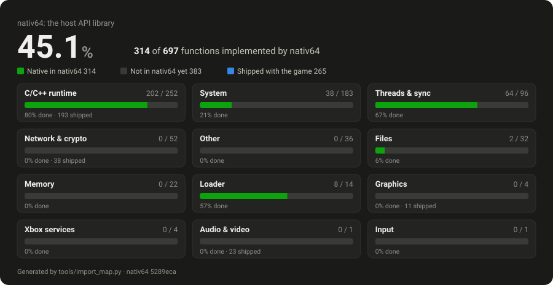

# nativ64

[](https://github.com/Ybucaille/nativ64/actions/workflows/ci.yml)
[](#license)
[](https://github.com/Ybucaille/nativ64/issues?q=is%3Aissue+is%3Aopen+label%3A%22good+first+issue%22)

**Xbox Series games on Linux, natively: no Wine, no Proton, function by function.**

Compatibility layers and recompilers already run Xbox Series code on a Windows PC.
Underneath, they all lean on the same thing: hundreds of Windows APIs borrowed from the
host (`kernel32`, `ntdll`, the C runtime, threads, files, sockets...). nativ64 rewrites
those APIs natively on Linux, as a standalone library that any of these projects can
load through a thin adapter.

The library is not tied to one game: the functions it implements are the same for every
title. Priorities come from the import map, which reads a game's import tables and shows
what is done and what is left. The first title measured is a large open-world game; more
titles can be added to the map, and functions shared by many games come first.



<details>
<summary>For comparison, what the first base already covers natively</summary>


</details>

For that first title (executable and package DLLs), 697 system functions are needed from
Windows (excluding the 265 its own DLLs ship). 46 already have portable code in
[VIctory](https://github.com/Marvisak/VIctory), the compatibility layer used as the first
base, 69 have VIctory code that still calls Windows, and **580 are host Windows APIs a
native port must write**.

## Stability first

Other projects aim to get a title on screen as fast as possible, borrowing whatever the
host Windows (or Wine) already provides. nativ64 takes the slower road on purpose: a
**stable, native Linux runtime** that does not inherit behaviour from a layer it does not
control.

- **Written and tested one function at a time.** Each function has its own tests,
  error cases included (null pointers, too-small buffers, overflows, timeouts,
  contention), and CI runs formatting, lints and tests on every push.
- **Exact Windows behaviour, Linux primitives.** Structure layouts and calling
  conventions match Windows bit for bit; underneath, it is plain Linux (futexes,
  syscalls), with no translation layer in between.
- **Once done, done.** A finished function is not revisited when the title changes or
  the base above it moves on, and every base that adopts the library gets it for free.

## How it fits

```
 compatibility layer (the "base": VIctory today, any other tomorrow)
        │  the title calls CreateFileW, VirtualAlloc, AcquireSRWLockExclusive...
   ┌────▼─────┐
   │ adapter   │  small, the only part tied to one base
   └────┬─────┘
 nativ64: the Windows APIs, reimplemented on Linux (Rust, Windows x64 calling convention)
        │
      Linux (syscalls, futexes, Vulkan, PipeWire...)
```

- **Base-agnostic.** The library knows nothing about the base above it. Switching base
  means writing a new adapter, not redoing the work.
- **Usable from Rust and C/C++.** Functions are exported with the Windows x64 calling
  convention and looked up by `module!function`, from Rust or through a C entry point.
- **Testable without the game.** Each function is checked against documented Windows
  behaviour on its own.
- **Measured.** The import map reads the title's import tables and shows, cell by cell,
  what is done and what is left, in one tab per base and one for this library.

## Status

Early. The import map is done, and the library implements 467 of the 697 functions the
first title needs (67.0%), each with tests: the C runtime math, string and conversion
functions, the lightweight thread synchronization (SRW locks, critical sections,
condition variables, wait on address), a handle table with events, mutexes and
semaphores, threads, thread-local storage, lock-free lists, the CRT heap, sorting,
random numbers, time and C locale, startup and exit, errno and invalid-parameter handler, module loading, an empty registry, plus a
first set of system calls. A native PE loader (`nativ64-run`) runs the first title's
executable through its C runtime startup, its package DLLs and its window, and creates
its Direct3D 12 device. The shader translator has started: a GFX10 decoder that reads
every program the first title ships (8634 programs, checked against `llvm-mc`) and an SSA
IR; no translated draw yet.
Left to write:

| Area | To write |
|---|---|
| System | 93 |
| C/C++ runtime (`api-ms-win-crt-*`) | 18 |
| Network & crypto | 47 |
| Threads & sync | 24 |
| Files | 10 |
| Memory | 19 |
| Loader | 3 |
| Other (Xbox services, graphics, input, audio...) | 16 |

Also needed, outside the library: SEH support in the loader, and a
Direct3D 12 to Vulkan path for the GPU.

## Getting started

Requirements: Linux x86-64, Rust (stable), Python 3 (no dependencies).

```bash
git clone https://github.com/Ybucaille/nativ64.git
cd nativ64
cargo test
```

To draw the import map you need your own, legally obtained copy of a game's files and,
for the base tabs, a VIctory checkout next to this repository. See [`docs/import-map.md`](docs/import-map.md).

## Contributing

The map is the to-do list: pick a grey cell, implement the function in `nativ64` with
its tests, open a pull request. [`CONTRIBUTING.md`](CONTRIBUTING.md) explains how, and
[`docs/library.md`](docs/library.md) covers the ABI rules (calling convention, 32-bit
`LONG`, UTF-16 strings, `SetLastError`).

Good first contributions: C runtime string and math functions, timing and system-info
calls, synchronization primitives on futexes.

## Layout

| Path | What |
|---|---|
| `crates/nativ64/` | The library: Windows APIs on Linux, one module per Windows module |
| `crates/nativ64-loader/` | The native PE loader ([`docs/loader.md`](docs/loader.md)) |
| `crates/nativ64-gpu/` | Graphics modules (Xbox Direct3D 12, XMem) ([`docs/gpu.md`](docs/gpu.md)) |
| `tools/` | Import map scripts and page template |
| `docs/` | Documentation |
| `game/` | Your local game files (not versioned) |
| `reports/` | Generated pages (not versioned: derived from game files) |

## Related projects

Other projects run Xbox Series (GDK) titles on a PC. They target Windows and translate
the console's graphics to the host's Direct3D 12; nativ64 targets Linux, with its own
host APIs and a Vulkan path, and is meant to sit under any of them.

| Project | Host | Approach | License |
|---|---|---|---|
| [VIctory](https://github.com/Marvisak/VIctory) | Windows | Compatibility layer: the title's x64 code runs natively, console libraries reimplemented, RDNA2 shaders recompiled to DXIL | GPL-3.0 |
| [DexNom Runtime](https://github.com/DexNom/VIctory) | Windows | Fork of VIctory focused on Radeon rendering and GPU memory | GPL-3.0 |
| [XCL](https://github.com/xcl-dev/xcl) | Windows | Compatibility layer in the spirit of Wine/Proton: own console libraries, RDNA2 shaders recompiled through HLSL to DXIL | GPL-2.0 |
| **nativ64** | **Linux** | Windows host APIs rewritten natively, a PE loader, Xbox Direct3D 12 on Vulkan (in progress) | MIT OR Apache-2.0 |

nativ64 contains no code from these projects; they are read as references for how the
console's interfaces behave.

## Legal

This project contains no game files, no console system files and nothing extracted from
them, and never will: you supply your own legally obtained copy. It is not affiliated
with Microsoft, any game publisher or any compatibility-layer project.

## License

Dual-licensed under [MIT](LICENSE-MIT) or [Apache-2.0](LICENSE-APACHE), at your option,
so any base can use the library, whatever its own license.
