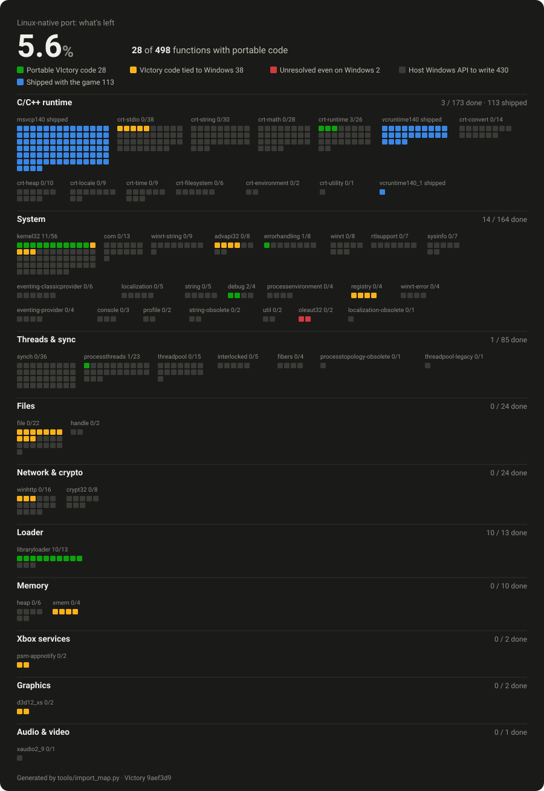

# Vice Native

A Linux-native port (no Wine) of the game, function by function.

Of the 498 system functions the game needs from Windows (excluding the 113 its own DLLs ship),
28 already have portable code in VIctory, 38 have VIctory code that needs porting off Windows,
430 are Windows APIs VIctory borrows from the host and a native port must write, and 2 are
unresolved even on Windows. This covers the package DLLs only, not the game executable yet.
Regenerate the chart as described in [`docs/import-map.md`](docs/import-map.md#readme-chart).

Not started yet. For now the project holds the tool that measures how far
there is to go:

- [`docs/import-map.md`](docs/import-map.md): the import map, a coverage map of every
  system function the game imports, with a view of what
  [VIctory](https://github.com/Marvisak/VIctory) already covers and what a native port
  still needs.

## Layout

| Path | What |
|---|---|
| `tools/` | Import map scripts and page template |
| `docs/` | Documentation |
| `game/` | Symlink to the game files in `../../vice-link/game` (not versioned) |
| `reports/` | Generated pages (not versioned: derived from game files) |

VIctory is expected as a checkout next to this project, in `../VIctory-mirror`.

## Next steps

- [ ] Run the import map on the executable once a legitimately obtained one is available.
